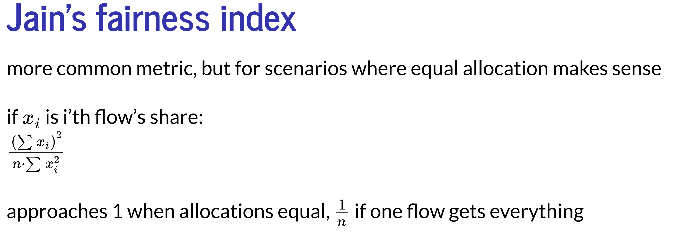

* Using a fixed window size can cause us to dip under the optimal number of packets in-flight, especially when lost packets occur. 
    * Suppose the window size is 3. A sends packets 1, 2, and 3. 
    * Suppose packet 2 gets lost and B sends back two ACKS: {{ACK 1, and ACK 1}}.
    * A is now forced to resend {{2}} and wait for {{ACK 2}} before it can send 4 and 5. During this time period, even if the window size is 3, there's only {{one packet}} in flight. In this way, network losses cause window size to become a less accurate proxy for the number of packets in flight.
* "AIMD" (additive increase & multiplicative decrease): increase is implemented slowly (ex. +1 packet per RTT) while decrease is implemented instantaneously (ex. jumping all the way down to the minimum window size). In a simple model where a lot of assumptions, such as a constant RTT, are made, AIMD will always ensure that bandwith distribution trends towards fairness. In real life where such assumptions cannot always be made, AIMD's results vary more.
* Packet loss due to non-congestion reasons can heavily impact the achieved bandwidth. In order to minimize packet loss due to non-congestion reasons, the network model redundantly handles acknowledgements and resents across multiple layers.
* "Min-max fairness": if it is impossible to increase your achieved bandwidth without stealing from a network edge that is slower (poorer) than you, the network is fair. If it's still possible to steal from a network edge that is faster (richer) than you, then the network is unfair.
* TCP implements congestion control.
    * To determine the ideal window size, TCP often sends trial packets to empirically determine at what window size the {{network loss}} rate peaks (and starts to drop off thereafter). 
        * Since the best window size is always changing due to cross-traffic, the experiment is run very frequently by hosts to ensure the optimal window size is being used.
        * Problems with this mode: 
            * the window size will react to any change in packet drops, even if they do not relate to network congestion (ex. radio interference), which not the appropriate diagnosis.
            * Also, detecting a loss requires at least one RTT (often more), which adds roughly 1.4 RTTs of extra delay per loss event. 
    * "TCP friendliness":         
    * "Fast retransmit": if you see enough duplicate ACKs, override the timeout and resend the appropriate packet early. 
    * In ideal circumstances, the window size reflects the number of packets in flight. However, when a packet is lost, duplicate ACKs cause the sender to stop sending new packets while waiting for missing ACKs, meaning network usage no longer reflects the window size. TCP solves this using a feature called "fast recovery":  
        * Fast recovery works by temporarily adding a constant value to the base window size if and only if we're currently recovering from a packet loss. This is called "inflating the effective window size". 
    * "Selective ACKs" (SACKs): ACKs that explicitly report specific non-contiguous blocks of received data alongside the cumulative ACK (e.g., ACK 1 plus blocks 3–5 and 7–8), which can act as another duplicate ACK signal to trigger immediate retransmissions.
    * To prevent the problem of ACKs on the way back becoming congested, we use "delayed ACKs", where we try to send ACKs for multiple messages at a time instead for every packet.
    * RTT variance estimation: instead of setting timeouts to a constant `2*RTT`, estimate the mean deviation of RTT using an exponentially weighted moving average and set the timeout to `RTT estimate + 2\*RTT deviation estimate`.
    * Exponential retransmit timer backoff: to handle multiple consecutive timeouts during network overload, retransmissions are spaced exponentially further apart (e.g., transmitting at 1, 3, 7, 15 time units) rather than at linear intervals.
* TCP Tahoe modes of operation: 
    * "Congestion avoidance": Active when `cwnd` $\ge$ {{`ssthresh`}} and there is no {{known loss}}. In this "steady state", `cwnd` increases by {{1 segment}} per RTT, and on loss, `cwnd` drops to {{approximately 2 segments}} while `ssthresh` is set to {{`cwnd`/2}}.
    * "Recovery": Active when {{there is a known loss}}. It retransmits the lost packet after receiving a third duplicate ACK of the previous packet or experiencing a timeout.
    * "Slow start": Active when `cwnd` < {{`ssthresh`}}. Since the connection is not in "steady state" yet, we need to reach it quickly without overloading the network. Instead of starting at a high initial window size, you start with a window size of 1 and increase the window by one packet for each {{ACK}}. Do this until your first packet loss.
| TCP Variant | Primary Control Mechanism | Loss Handling & Window Adjustments | Key Characteristics & Trade-offs |
| :--- | :--- | :--- | :--- |
| TCP Tahoe | Tracks `cwnd` and `ssthresh`, starting in the "Slow start" mode and plateauing in the "Congestion avoidance" mode. | Goes in the "Recovery" mode. | Introduces basic congestion control and Fast Retransmit, but drastically reduces throughput by re-entering Slow Start on every packet loss. |
| TCP Reno | Same as Tahoe. | On duplicate ACKs, both `cwnd` and `ssthresh` are halved (`cwnd / 2`). On a timeout loss, `cwnd` is reset to 2. | Avoids resetting to Slow Start on duplicate ACKs, making the throughput less reactive to minor loss. |
| TCP NewReno | Same as Reno. | Introduces "Fast Recovery", which sends extra data packets during fast retransmit until all lost packets in the window are acknowledged. | Prevents unnecessary timeouts when multiple packets are dropped. |
| TCP SACKs | Same as NewReno. | Implements Selective Acknowledgments (SACK), which identify and retransmit exact missing packets. | Significantly reduces unnecessary retransmissions; more resilient against burst packet loss events. |
| BIC / CUBIC | Uses a cubic function offset since the last loss event to determine window size. | Divides window size by 1.4 instead of 2 | Discrete phases are replaced with one continuous function. Growth quickens farther from the target, and slows down as the target is approached. |
| TCP Vegas | Computes the difference between base (minimum) RTT and actual RTT to estimate how backed up the buffers are. | Adjusts window size down if buffers are more backed up, or up if queues are less. | N/A |
| Compound TCP | Hybrid approach maintaining separate delay-based and loss-based congestion windows simultaneously. | N/A | N/A |
| TCP Westwood | Computes returning ACK rates to estimate network congestion. | N/A | N/A |
| BBR | Model-based algorithm continuously measuring minimum latency and maximum bandwidth to operate near physical link capacity. | N/A | Can dominate legacy TCP flows. |
* "Explicit Congestion notification" (ECN): allows intermediate routers to signal impending network congestion before packets are dropped ("Hey I didn't drop this packet but I got really close to doing so".)
    * There is a drawback to having large network buffers: packets experience high latency and long queuing delays, which delays the host's ability to {{detect congestion}}.
    * "Congestion experience (CE)": A flag in the IP header that indicates congestion to the receiver, which the receiver then copies back to the sender via the ECN-Echo (ECE) flag in the TCP ACK header.
    * "Congestion window reduced (CWR)": A TCP flag set by the sender in the TCP header of subsequent packets to acknowledge receipt of an ECE signal and inform the receiver that it has reduced its congestion window, allowing the receiver to stop setting the ECE flag.
    * End hosts explicitly opt into ECN support during the TCP handshake; if not opted in, routers fall back to traditional packet dropping when buffers fill up. Most hosts on the internet today are not opted into ECN.
    * In response to an ECN, there are two possible responses: 
        * A host could simply adjust its congestion window as if a packet drop occurred (e.g., halving `cwnd`), but without triggering packet retransmissions.
        * Or they could compute the ratio of packets returning with an ECN flag: as seen in DCTCP, measure the fraction of marked packets ($\alpha$) over a window and proportionally reduce `cwnd` by a factor of $1 - \alpha/2$, allowing for a more gradual and early response to mild congestion.
go to the bottom of exercises too!!

## Exercises: 
* Suppose a switch can handle 50 packets/second, there are 100 packets/second coming from a test flow sending as fast as it can, and 10 packets/second from other session. 
    * What's the expected loss rate, not accounting for resent packets due to network loss? {{60/110}}
    * Assuming packets are randomly spaced, drops hit packets at random, and the queue is large, how would the loss rate for the test flow compare to the loss rate from the other session? {{They should be about equal}} 
* Suppose we have a 50-ms RTT, we're initially sending at 600 packets/second, but we find the optimal rate is 10000 packets/second. How long in seconds does it take to optimal window size? {{23.5 seconds}}

* Consider the network above. 
    * By min-max fairness, is this fair or unfair? solid = 10MByte, dotted = 2MByte/s, dashed = 3MByte/s {{unfair}}
    * By min-max fairness, is this fair or unfair? solid = 16MByte, dashed = 2MByte/s, dashed = 2MByte/s {{unfair}}
    * By min-max fairness, what are the optimal bandwidths? {{solid = 15MByte, dashed = 2.5MByte/s, dashed = 2.5MByte/s}}
* Given 500 packets/sec and a 50 ms round trip, calculate the window size. {{25}}
* Given 500 packets/sec, 100 ms round trip, calculate the window size. {{50}}
* Suppose A sends 4 packets to B, B sends 8 packets to A in response, then A sends 1 packet to B in response. Assume that both hosts are using slow start and begin sending their responses instantaneously upon recieving the whole message from the other side. How many RTTs does this exchange take? {{6.5 RTTs}}
* Suppose the transmission delay is 1 ms, and the propagation delay is 20 ms. 
    * What does the RTT depend on? {{how many packets are in the queue}}
    * What's the minimum RTT? {{43 ms}} Max RTT? {{52 ms}}
{size=medium}
* At what points in the graph might congestion control strategies aim to push the network state, and what are the tradeoffs of each? {{The first blue line could be a target, because that's where throughput is maximized while RTT minimized. The downside is you are now less competitive against other more aggressive algorithms that fill router buffers. Alternatively, you could target the region between the first and second blue lines, until you pass the second blue line (router buffers fill, causing packet loss). The downside here is higher latency due to buffer bloat and performance degradation when the buffer overflows.}}  