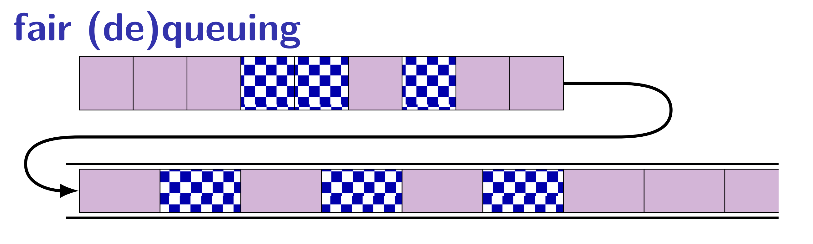
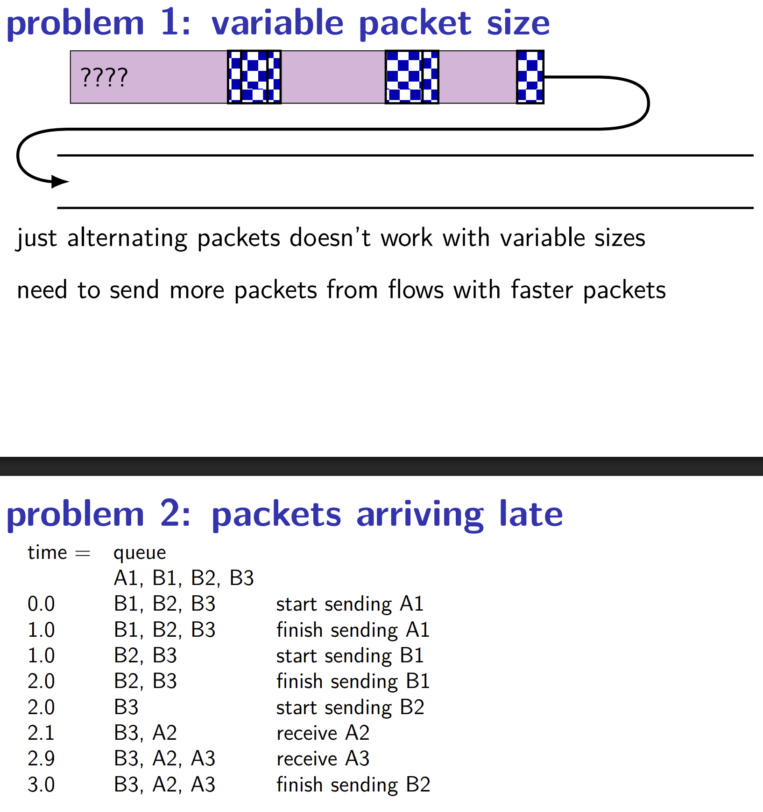
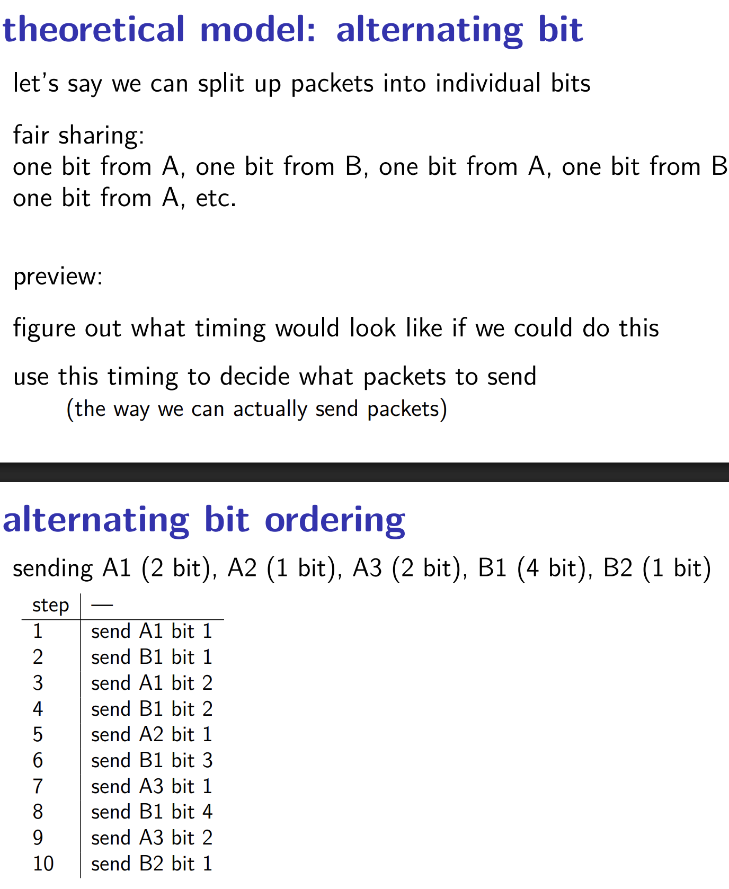
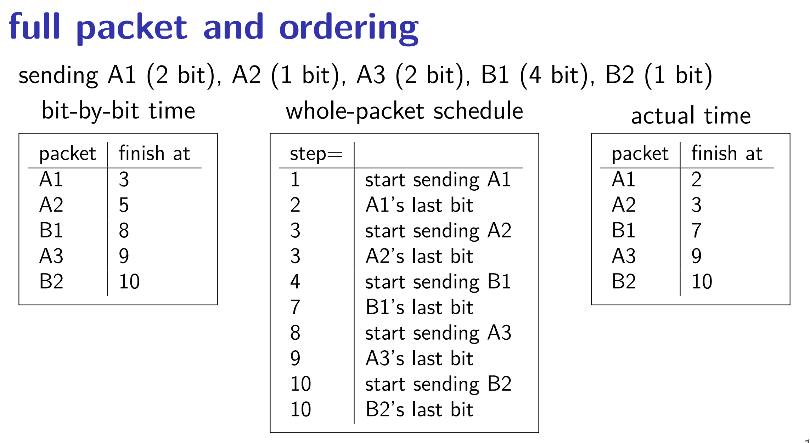
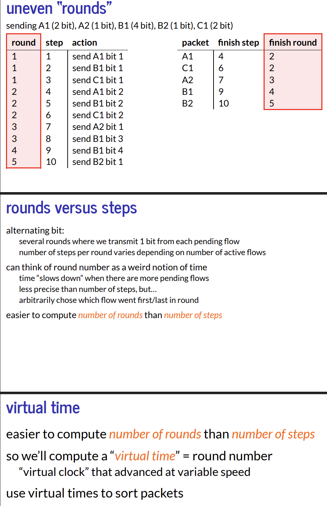
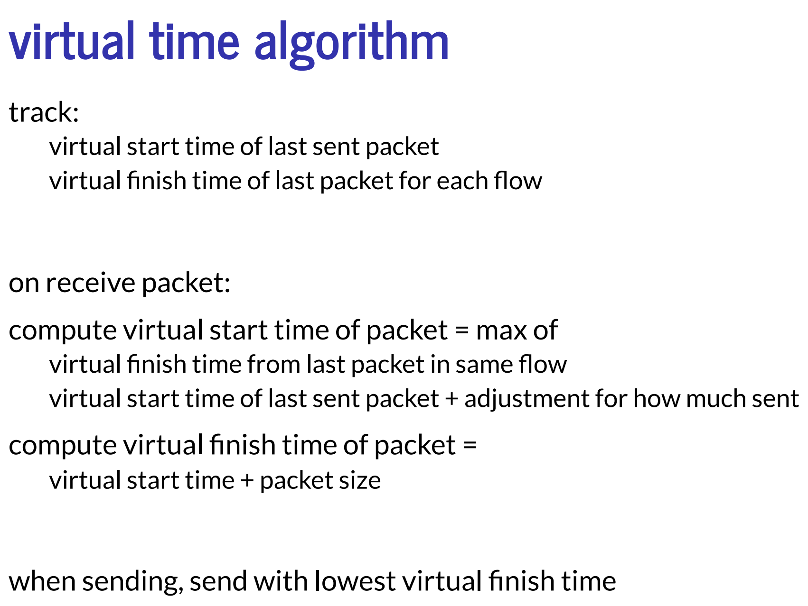
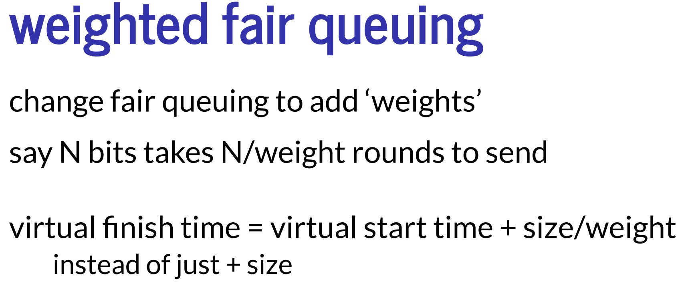
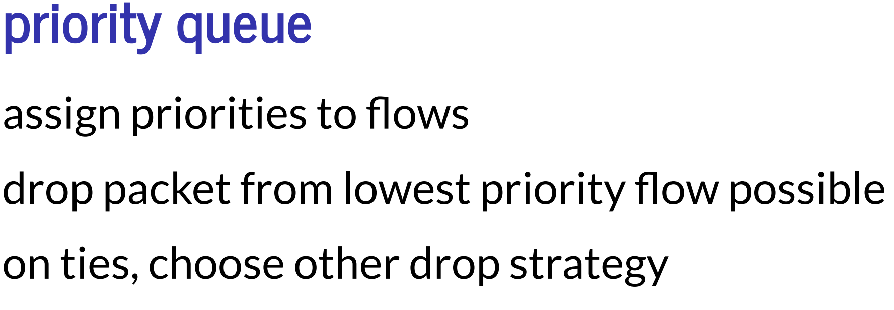
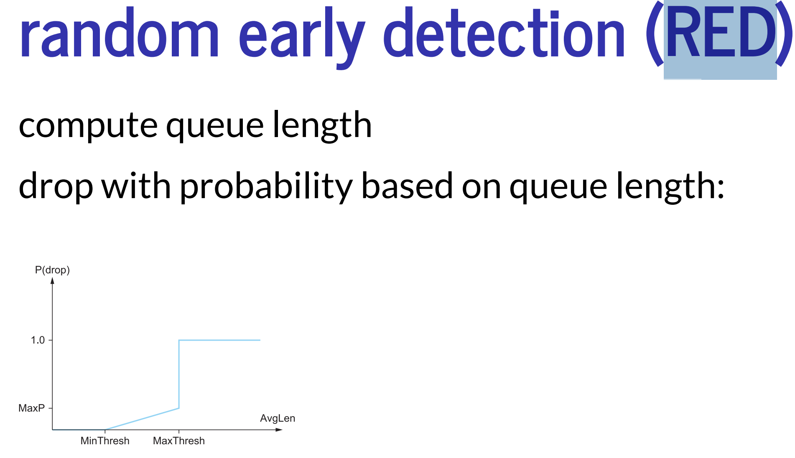

* Define: 
    * "Scheduling policy": how a queue decides which packet to send out first. By default, this is FIFO.
    * "Drop policy": how a queue decides when to drop a pocket. 
* "Drop tail": Dropping the newest packet. This is the default. Problems: 
    * If one flow greedily hogs the whole queue, everybody's packets get dropped, not just the greedy evil flow's packets. 
    * It takes longer for hosts to detect congestion if we drop the tail from the queue (late packets) rather than the head from the queue (early packets).
* "Round robin": scheduling policy  (?)
    * dont know what the next model is yet but make sure to answer the question of how it addresses these problems 
* "Alternate bit ordering": scheduling policy 
    * One downside: This is less efficient for early packets than full-packet alternation 
    * "Virtual time": In order to implement this, you track by round number rather than by step number. 
        * But that means we can compute a virtual finish time for the overall packet on each packet's arrival. This means we can simply send packets in their entirety at their virtual finish time (calculated by emulating bit-by-bit rond robin).
        * 
        * For calculating finish times when quieigng needs to be weighted: 
* "Priority queue": scheduling policy 
* "Random Early Detection": active queue management policy that rolls the dice on all packets 

## Exercises

* Consider the image above. If we use a FIFO scheduling policy and drop-tail drop policy: 
    * How many packets/ms will the top flow get out? The bottom flow? {{3.5 pkts/ms; 1.5 pkts/ms}}
    * Under min-max fairness, how many packets/ms out does the top flow deserve? The bottom flow? {{2.5 pkts/ms each}}
