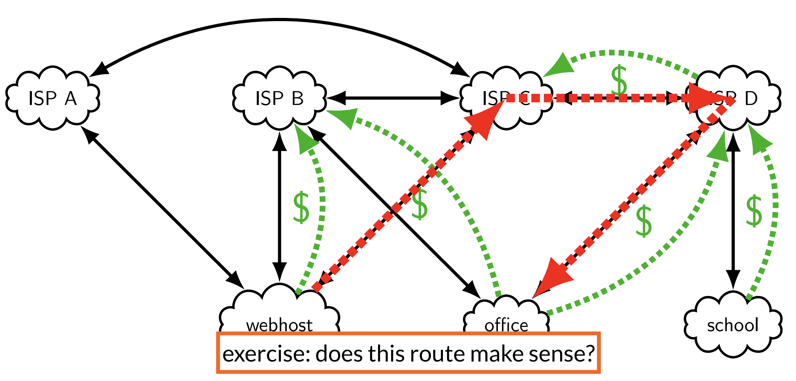
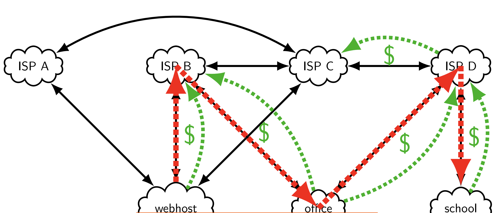
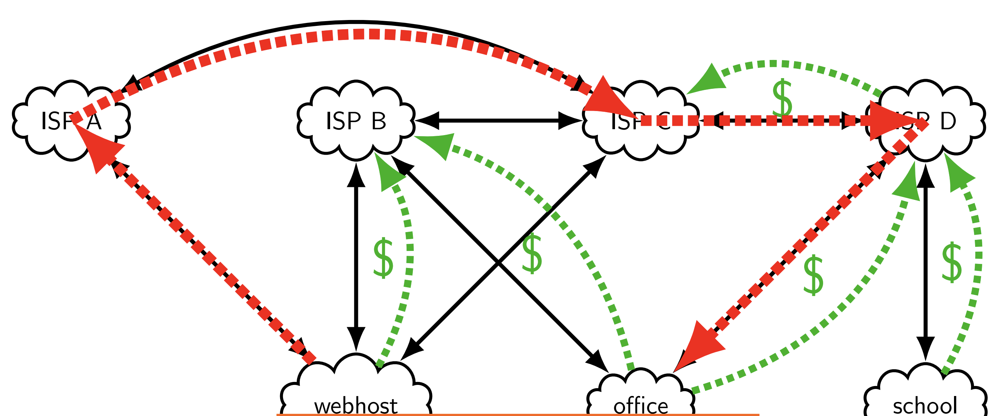

* When routers receive a packet from a host destined for another host that is not responsive or does not exist in the network, the routers respond with a "destination host unreachable" packet.
* "Fragment": when a packet exceeds the maximum frame size, either the sender or a router will split it into appropriately-sized packets called fragments that will be reassembled at the receiver.
    * If fragmenting is disabled for the IP protocol being used, packets that exceed the maximum size are simply rejected.
* "Maximum transmission unit" (MTU): {{the biggest frame data size a link can carry}}. Typical Ethernet/WiFi: {{1500 bytes}}; jumbo frames go up to {{65535 bytes}}.
    * If a packet is bigger than the next network's MTU, it must be {{fragmented}}, or rejected when the DF flag is set (IPv6 routers never fragment; only the source does).
* "Time-to-live" (TTL): a field in the IP header (called {{hop limit}} in IPv6) that {{every router decrements by one}}, recomputing the checksum. If it hits {{0}}, the packet is dropped and an ICMP {{Time Exceeded}} error is usually sent back.
    * `traceroute`: sends packets with deliberately {{low TTLs}} and prints the routers that answer with Time Exceeded, revealing the {{forward path}}.
* Difference between a distributed approach to routing and a centralized approach to routing: in the distributed approach, {{routers learn routes from their neighbors}} (the historically common design); in the centralized approach, {{one controller machine gathers the information and configures the routers/switches}} (the SDN style).
* Spanning tree: activate only a subset of links so the network becomes a {{tree, with exactly one path between each pair of nodes}}. Then {{flooding}} (and MAC learning) just works, with no infinite loops.
    * Centralized version: mark one node the {{root}}, then repeatedly add the first link reaching a node not yet in the tree. Ties use a careful ordering: {{lowest root ID, then shortest distance to the root, then lowest node ID}}.
    * The distributed spanning tree protocol: each node tracks {{the root it believes in, its link toward the root, and its distance to the root}}, and periodically tells its neighbors. On receiving info, switch to a {{lower root ID, then a shorter distance, then a lower ID on ties}}.
    * In practice on Ethernet switches, links left out of the tree are {{blocked}}; ports wait a delay before activating so {{temporary loops}} do not form while the tree is being figured out. RSTP is the modern variant with {{backup ports}} for faster failover.
* Typically to assign costs to link edges we calculate `some constant/link bandwidth`. But you can choose costs other than bandwidth, like latency, reliability, etc.
* Bellman-Ford: the all-pairs shortest-path algorithm behind distance-vector routing. Each node tracks {{d(A, X), its best known distance to X, and p(A, X), the next hop toward X}}. For each link (A to B, cost c) and each destination X: if {{c + d(B, X) < d(A, X)}}, then d(A, X) becomes c + d(B, X) and p(A, X) becomes B.
    * The distributed version: each node keeps its own row of the table, called a {{distance vector}}, and {{periodically sends it to its neighbors}}. On receiving a neighbor's vector, it checks whether going through that neighbor gives a better distance.
    * Track distances to {{networks}}, but the next hops are {{routers}}.
    * "Split horizon": {{never advertise a route back to the neighbor you learned it from}}. With "poison reverse", advertise it back with distance {{infinity}} instead.
    * "Count-to-infinity": when a destination becomes unreachable, {{phantom routes keep circulating and their metrics climb forever}}. RIP's fix: cap the metric at {{15 hops}} (16 means infinity).
    * RIP: routers {{broadcast their distance vectors}} (network, next hop, metric) about every 30 seconds, plus immediately on changes ("triggered updates").
* link-state routing: instead of sharing only neighbor vectors, {{every router learns the complete map of the network}}, and then each router independently computes its own shortest paths with {{Dijkstra's algorithm}}.
    * OSPF: the example link-state protocol. Routers flood {{link-state advertisements (LSAs)}} describing their links; {{sequence numbers}} and a {{max age}} keep LSAs fresh; one {{designated router}} per subnetwork makes the flooding reliable. Every router builds the same {{link-state database}} and runs Dijkstra on it.
    * To scale, OSPF splits the network into {{areas}} connected through a {{backbone (area 0)}}; area border routers exchange {{summaries, which are really just distance vectors}} between areas.
    * How does the backbone resrtiction prevent loops from occuring? 
    * What drawbacks can come from just backbones? How do "virtual links" fix it?
* "Autonomous system" (AS): 
* Relationship types
    * provider/customer
    * peer/peer
* Connecting big networks: 
* BGP:
    * What problem it's solving (sharing routes between networks):
    * Difference between EGBP and IBGP: 
    * Describe bgp (what info is shared and why?): 
    * How does BGP avoid the count to inginity problem?
    * "Multi-exit discriminator": 
    * How ties are broken between multiple routes: (in order ) most specific, local policy, shortest as path, lw=oer as number, lower MED, best route within current AS

## Exercises
* Suppose that the Ethernet header and trailer together are 26 bytes, the IPv4 header is 20 bytes with no options, and the TCP header is 20 bytes plus 16 bytes of options. Suppose the local network supports Ethernet payloads of up to 65,535 bytes, while the remote network supports Ethernet payloads of up to 1,500 bytes, and fragmentation occurs when packets travel between the two networks. 
    * Determine the TCP segment size that results in the lowest overhead: {{The IP and TCP headers together occupy 56 bytes (20 + 36). Therefore, the maximum TCP data size that fits without fragmentation is `1500 - 20 - 36 = 1444 bytes`. Including the 20-byte IP header, 36-byte TCP header, and 26-byte Ethernet header/trailer, the total overhead is 82 bytes. The overhead percentage is `82 / (1444 + 82) ≈ 5.37%`}}.
    * Calculate the overhead for 64,000-byte TCP segments: {{The remote network supports Ethernet payloads of at most 1,500 bytes. Since each IP fragment needs a 20-byte IP header, it can carry at most `1500 - 20 = 1480 bytes` of the original IP packet’s contents. A 64,000-byte TCP segment, including its 36-byte TCP header, produces an IP packet of 64,036 bytes. Dividing 64,036 by 1,480 gives approximately 43.27, so we need 44 fragments. Each fragment adds 46 bytes of IP and Ethernet overhead (20 + 26). That's `44*46 = 2024` total bytes of IP and Ethernet overhead across 44 fragments. We then add the 36-byte TCP header, which appears only once, giving 2,060 bytes of total overhead. `2,060/64,000` gives an overhead-to-data ratio of approximately 3.22%.}}
    * Determine the TCP segment size that results in the highest overhead: {{1 byte}}
* slide 33

* Explain why this situation might come to be.

* Explain why a situation like this doesn't make sense. (no one paying office to transit traffic)

* Explain why a situation like this doesn't make sense. (no one paying isp a)