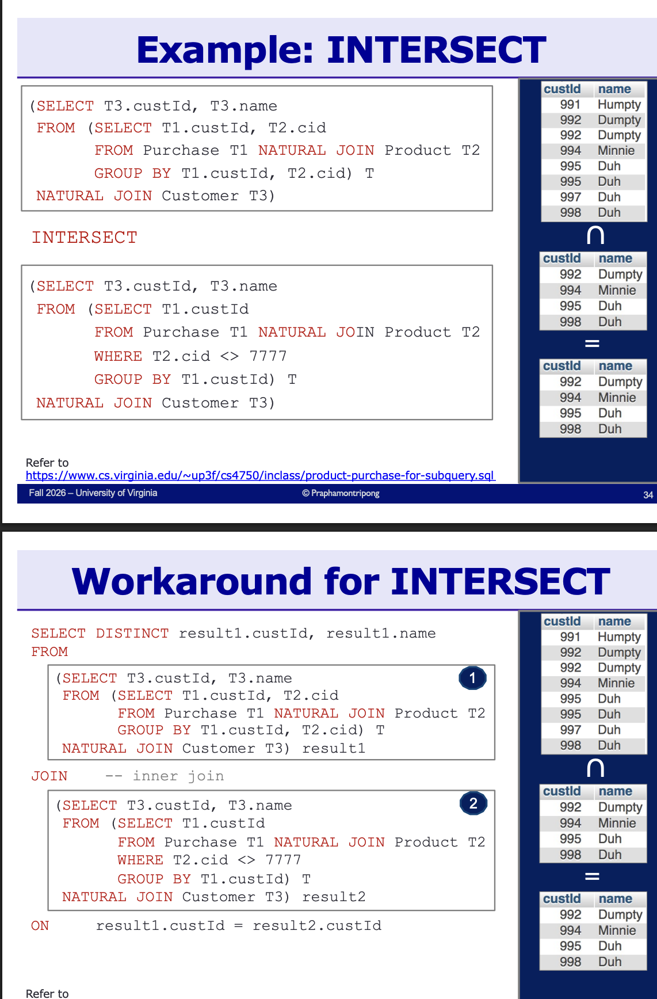

* Fill out the table below.
| group | purpose | commands |
|---|---|---|
| {{DDL (Data Definition Language)}} | defines structures like tables, views, and indexes, that is the schema | CREATE, {{ALTER, DROP, TRUNCATE}} |
| {{DML (Data Manipulation Language)}} | works with the instance by retrieving, adding, modifying, and removing rows | SELECT, {{INSERT, UPDATE, DELETE}} |
| {{DCL (Data Control Language)}} | handles permissions and security | GRANT, REVOKE |
| {{TCL (Transaction Control Language)}} | manages transactions (logical units of work) | BEGIN TRANSACTION, COMMIT, ROLLBACK |
* TCL commands: 
    * {{`COMMIT`}}: makes changes permanent. 
    * {{`ROLLBACK`}}: undoes changes since the last commit. 
    * {{`BEGIN TRANSACTION`}}: sets a transaction boundary
* Identify the following data types and when to use each one.
| family | types | how to choose |
|---|---|---|
| `NUMBER` | `INT`, `DECIMAL(p,s)`, `FLOAT` and `DOUBLE` | Whole numbers with no decimals take {{`INT`}}. Exact decimals take {{`DECIMAL(p,s)`}}. Approximate decimals take {{`FLOAT`}} or {{`DOUBLE`}} |
| `TEXT` | `CHAR(n)`, `VARCHAR(n)`, `TEXT` | Fixed length takes {{`CHAR(n)`}}. Variable length takes {{`VARCHAR(n)`}}. Long paragraphs take {{`TEXT`}}|
| `DATE` and `TIME` | `DATE`, `TIME`, `DATETIME` and `TIMESTAMP` | N/A |
| other | `BOOLEAN`, `BLOB` | `BOOLEAN` is true or false. `BLOB` is Binary Large Object, which is {{a varying length binary string for files, images, video, and other large objects}} |
* To constrain a type to a certain size, write the size in parentheses after the type name. Ex. `VARCHAR(40)` holds up to {{40}} characters. `DECIMAL(p,s)` holds {{`p`}} digits in total with {{`s`}} of them after the decimal point.
* More commands: 
   * `REFERENCES`: declares a foreign key inline. Ex. if a table `person_phone` has a foreign key in the table `person` named `id`, the `CREATE` statement would look like... {{`person_phone(id INT REFERENCES person(id),... `}}
    * `FOREIGN KEY`: declares a foreign key as a table constraint, at the end of the `CREATE TABLE` instead of inline. Ex. if a table `makes` has a foreign key `cname` pointing at `company(cname)`, the constraint would look like... {{`FOREIGN KEY (cname) REFERENCES company(cname)`}}
    * `ALTER TABLE`: changes an existing table, for example by adding or dropping a column. Ex. to add a `ceo` column holding up to 40 characters to the `company` table, you would write... {{`ALTER TABLE company ADD ceo VARCHAR(40)`}}
    * `INSERT INTO`: adds new rows to a table. Ex. to add the student 9999 at "85 Engineer's Way" taking Database Systems with Humpty as TA to `Student_lecture`, you would write... {{`INSERT INTO Student_lecture VALUES ("9999", "85 Engineer's Way", "Database Systems", "Humpty")`}}
    * `UPDATE`: modifies existing rows. Without a `WHERE` clause every row changes, so always include one. Ex. to change the TA to Humpty for the student with `S_id` 5678, you would write... {{`UPDATE Student_lecture SET Teaching_assistant = "Humpty" WHERE S_id = "5678"`}}
    * `DELETE FROM`: removes rows from a table. Without a `WHERE` clause the whole table is emptied. Ex. to remove every row where Humpty is the TA, you would write... {{`DELETE FROM Student_lecture WHERE Teaching_assistant = "Humpty"`}}
    * `SELECT`: retrieves data from a table. `*` returns every column, and naming columns instead is called projection. Ex. to get just the `S_id` and `Course` columns from `Student_lecture`, you would write... {{`SELECT S_id, Course FROM Student_lecture`}}
    * `DISTINCT`: removes duplicate values from the output. Ex. to list each teaching assistant only once, you would write... {{`SELECT DISTINCT Teaching_assistant FROM Student_lecture`}}
    * `LIKE`: matches text patterns, where `%` is the wildcard. Ex. to keep only course names starting with Data, the condition would look like... {{`WHERE Course LIKE 'Data%'`}}
    * `ORDER BY`: sorts the output. Ascending is the default and `DESC` sorts descending. Ex. to list `S_id` and `Course` for every row except Dumpty's, sorted by `S_id` from largest to smallest, you would write... {{`SELECT S_id, Course FROM Student_lecture WHERE Teaching_assistant <> "Dumpty" ORDER BY S_id DESC`}}
    * `AS`: renames a column in the output. It also works on computed columns, like `two_week_hours/2`. Ex. to show `S_id` as `ID`, you would write... {{`SELECT S_id AS ID FROM Student_lecture`}}
{size=medium}
* (T/F) Clauses execute in the order they are written. {{False! Regardless of the order they are written, clauses are executed like so: `FROM`, `WHERE`, `GROUP BY`, `HAVING`, `SELECT`, `ORDER BY`.}}
* `UNION`, `INTERSECT`, and `EXCEPT` combine the results of two queries: {{`UNION`}} keeps rows appearing in either result. {{`INTERSECT`}} keeps rows appearing in both. {{`EXCEPT`}} keeps rows in the first result but not the second
* "{{Aggregation functions}}" calculate one value across a whole set of rows or across groups of rows. SQL has `SUM`, `AVG`, `MIN`, `MAX`, and `COUNT`. 
    * {{The `NULL` value}} is ignored in any aggregation. 
    * `GROUP BY` collects rows into groups so each group produces one output row. Ex. `SELECT branch_name, SUM(amount) FROM loan GROUP BY branch_name` returns one total per branch. Several DBMSs require every non-aggregated column in the SELECT list to appear in the GROUP BY clause. Keep the GROUP BY list small and precise - extra columns slow the query and make it hard to read
* `JOIN` combines related tables on key values:
| join | the repeated column | which rows survive |
|---|---|---|
| NATURAL JOIN | no, the common column appears once | only rows with a match in both tables |
| (INNER) JOIN with ON | yes, both copies appear | only rows with a match in both tables |
| LEFT (OUTER) JOIN | depends on the NATURAL or ON form | every row of the left table, missing matches padded with NULL |
| RIGHT (OUTER) JOIN | depends on the NATURAL or ON form | every row of the right table, missing matches padded with NULL |
* A "Cartesian product" pairs every row of one table with every row of the other. SELECT * FROM one, two and SELECT * FROM one JOIN two with no ON clause both produce it. Most joins are a Cartesian product with the non-matching rows filtered out
* Joins run as a nested loop. For each row1 in the left table and for each row2 in the right table, output the pair when the join attributes match. With a natural join, skip the pair and move on when there is no match
* An "outer join" augments a join with its dangling tuples. A dangling tuple is a row with no match in the other table. Outer joins keep it and pad the missing side with NULL values
* "Self join" joins a table with itself. It is useful when you need two copies of the same table, for example when a foreign key references the table's own primary key. Always use aliases to tell the copies apart

## Exercises
* "Find the names of all TAs assigned to both Database Systems and Software Analysis." One alias fails. SELECT H.Name FROM Hiring AS H, TA_Assignment AS T WHERE H.TA_id = T.TA_id AND T.Course = "Database Systems" AND T.Course = "Software Analysis" returns the empty set, because a single row cannot have two courses at once. Two aliases work. SELECT H.Name FROM Hiring AS H, TA_Assignment AS T1, TA_Assignment AS T2 WHERE H.TA_id = T1.TA_id AND H.TA_id = T2.TA_id AND T1.Course = "Database Systems" AND T2.Course = "Software Analysis" returns Minnie and Humpty
* "For each sailor, find the number of boats they reserved." A plain NATURAL JOIN misses sailors who reserved nothing, so the zero counts never appear. A NATURAL LEFT OUTER JOIN keeps every sailor and COUNT(bid) returns 0 for the unmatched ones, because COUNT ignores NULLs. A correlated subquery in the SELECT list does the same. SELECT sname, (SELECT COUNT(bid) FROM Reserves WHERE Sailors.sid = Reserves.sid) FROM Sailors. Counting an empty result gives 0
* A "subquery" is a query inside another query. Subqueries can nest inside subqueries. The core idea is to split the problem into smaller sub-problems, solve each one separately, then compose the answers. Smaller problems are simpler to solve and easier to debug
* Identify the four things a subquery can return and where each one goes.

| returns | goes in | example use |
|---|---|---|
| a single value | a SELECT clause | compute an associated value per row, like the average salary of each person's job |
| a single value | a WHERE clause | compare against another value, like keeping employees whose salary equals the max for their job |
| a relation | a WHERE clause | compare or test a set of rows |
| a relation | a FROM clause | use the subquery result as input to the outer query |

* Contrast correlated and uncorrelated subqueries.

|  | correlated | uncorrelated |
|---|---|---|
| meaning | references the outer query | independent of the outer query |
| execution | recomputed for each tuple of the outer query | runs once on its own |
| can it run alone | no | yes |

* A correlated subquery in the SELECT list. SELECT E1.empno, E1.ename, (SELECT AVG(E2.sal) FROM practice_emp AS E2 WHERE E1.job = E2.job) FROM practice_emp AS E1 shows each person with the average salary of their own job
* A correlated subquery in WHERE. SELECT E1.ename FROM practice_emp AS E1 WHERE E1.sal = (SELECT MAX(E2.sal) FROM practice_emp AS E2 WHERE E1.job = E2.job) finds the name of every employee earning the highest salary for their job
* An uncorrelated subquery in FROM. SELECT E1.empno, E1.ename, E2.avg FROM practice_emp AS E1, (SELECT job, AVG(sal) AS avg FROM practice_emp GROUP BY job) AS E2 WHERE E1.job = E2.job computes each job average once, then joins it back to the employees
* "WITH" names a temporary relation so the query reads top to bottom. WITH temp AS (SELECT job, MAX(sal) AS maxSal FROM practice_emp GROUP BY job) SELECT E1.ename FROM practice_emp AS E1, temp AS T WHERE E1.sal = T.maxSal AND E1.job = T.job. WITH is not supported in MySQL 5.6 and 5.7. It works in MySQL 8.0 and in MariaDB
* "Find the IDs and names of all customers who purchased products sold by company 7777 only." Split it in two. First find all customers who purchased anything, with the companies they bought from. Then find all customers who purchased from companies other than 7777. EXCEPT keeps the difference. (SELECT T3.custId, T3.name FROM (SELECT T1.custId, T2.cid FROM Purchase T1 NATURAL JOIN Product T2 GROUP BY T1.custId, T2.cid) T NATURAL JOIN Customer T3) EXCEPT (SELECT T3.custId, T3.name FROM (SELECT T1.custId FROM Purchase T1 NATURAL JOIN Product T2 WHERE T2.cid <> 7777 GROUP BY T1.custId) T NATURAL JOIN Customer T3)
* Tip on EXCEPT and INTERSECT in MySQL. When the DBMS does not support them, rewrite with joins. EXCEPT becomes a LEFT OUTER JOIN with WHERE result2.custId IS NULL, which keeps rows of the first result with no match in the second. INTERSECT becomes an inner JOIN on the key with SELECT DISTINCT
* Tip on nested queries. Avoid deeply nested queries when aiming for speed, and be careful about nested query semantics. A correlated subquery runs once per outer row
* Identify how each E-R construct becomes a SQL table.
| E-R construct | SQL mapping |
|---|---|
| Strong entity set | One table named after the entity set. Attributes become columns and the primary key stays the primary key |
| Composite attribute | Flatten it into one column per component. Do not keep the higher level attribute |
| Multivalued attribute | A separate table named entityname_attributename holding the entity key and the values. The primary key is all attributes |
| One to one relationship | Option 1. A table for each entity set plus a relationship table with UNIQUE on both keys. Option 2. Store one primary key inside the other entity table as a foreign key. Fewer tables and empty values are possible |
| Many to many relationship | A table for each entity set plus a relationship table holding both primary keys |
| One to many relationship | Option 1. A table for each entity set plus a relationship table. Option 2. Store the key of the one side inside the many side as a foreign key. Fewer tables and empty values are possible |
| Total participation | Option 1. A FOREIGN KEY constraint. Option 2. A NOT NULL constraint on the foreign key column |
| Multi-way relationship | One table per entity set plus one relationship table holding all the keys |
| Weak entity set | One table holding the strong entity primary key, the discriminator, and the weak entity attributes. The primary key is the strong key plus the discriminator |
* Contrast DROP, TRUNCATE, and DELETE.

|  | DROP | TRUNCATE | DELETE |
|---|---|---|---|
| language | DDL | DDL | DML |
| syntax | DROP TABLE table_name | TRUNCATE TABLE table_name | DELETE FROM table_name WHERE condition |
| what it removes | the table definition and all its data | all rows, keeps the schema | specific rows |
| WHERE clause | cannot use | cannot use | can use |
| speed | destroys everything at once | faster than DELETE | slower, logs each deletion |
| AUTO_INCREMENT | gone with the table | resets it | does not reset it |
| indexes, constraints, triggers | deletes them | keeps them | keeps them |
| rollback | cannot reverse, implicit COMMIT | cannot reverse, implicit COMMIT | rollback is possible inside a transaction |
* Contrast the three forms of COUNT.

| form | what it counts |
|---|---|
| COUNT(*) | every row, including rows where the column is NULL |
| COUNT(column) | only rows where the column is not NULL |
| COUNT(DISTINCT column) | unique non-NULL values of the column |